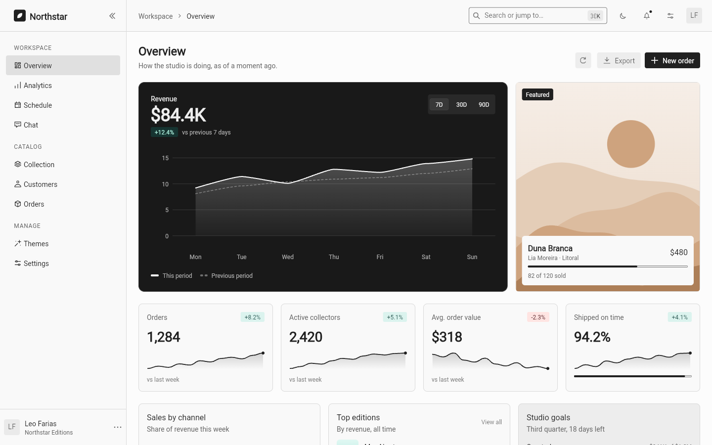
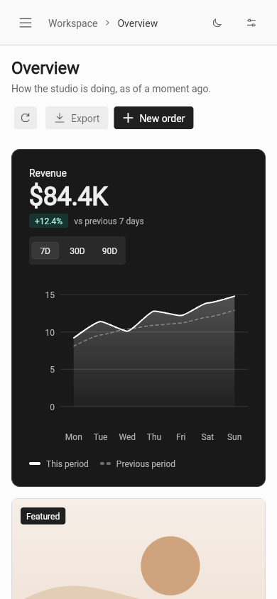

# Dashboard

A reference product dashboard demonstrating Remix's Fortal theme, components,
Mix layouts, and chart recipes built on `mix_chart`. The product is Northstar
Editions, a studio that sells limited-edition prints.

## Showcase role

This app is the Fortal showcase: how its components and its seven palettes
compose into one realistic product, across nine destinations:

| Destination | Shows |
| --- | --- |
| Overview | A bento with an emphasis hierarchy: revenue on the one inverse surface, a full-bleed featured cover, metric cards with trend lines, a channel donut, goals on an accent wash, a flush orders table, and quiet calendar and team cards |
| Analytics | A summary strip, the revenue chart at ordinary weight, a stacked bar chart, sell-through with covers, and a channel table |
| Schedule | The calendar beside the chosen day, an agenda filtered by a date range picker, and a dialog that dates a new event with a date picker |
| Chat | The Agent surfaces together. No model or tool service is contacted |
| Collection | Every edition as an image card or a table row, with a spotlight card, status tabs, a price range slider, search, and a detail dialog with an accordion |
| Customers, Orders | Summary figures over searchable, sortable, paginated tables filtered by tabs |
| Themes | The seven palettes (Orla, Mar, Céu, Serra, Sol, Duna, Caju) as cover cards that apply on a tap, the rest of the theme as controls, and a specimen of every button and badge variant, the selection and range controls, and inline type |
| Settings | Profile, notifications, live appearance, and plan, one tab each |

The header's quick-find field (`⌘K`, or `Ctrl K`) lists matching pages,
editions, customers, orders and palettes, and jumps to the one chosen. The
Overview also carries the seven palettes as one-tap buttons. The [component catalog](../demo/) remains
the exhaustive source for every variant, size, API state, and preview knob;
the dashboard is the copyable product implementation.

## Registry ownership

The dashboard selects the Fortal preset with prefix `Ui` in `remix.yaml`.
Its full component catalog, eight Agent recipe bundles, and the Fortal
`dashboard_demo` recipe are installed under `lib/ui/`; `tool/check_consumer_apps.dart`
compares them with the bundled registry. `apps/dashboard/lib/main.dart` is a
thin entry point that mounts `UiDashboardDemo` inside a `UiDashboardThemeScope`
and `UiTheme` with a local simulated chat runner. The separate
`dashboard_shell` item remains the minimal shell starter for custom pages.
The [Agent component docs](../../docs/agent/transcript.mdx) describe
installation and host responsibilities.

## Reference rules

- Emphasis is a dashboard-owned policy, `UiSurface`, with four levels:
  `standard`, `tinted`, `quiet` and `inverse`. Fortal cards never cast a
  shadow, so hierarchy comes from fill and contrast. The inverse surface nests
  a theme of the opposite appearance, so everything inside keeps its contrast
  without special cases. A page uses it once.
- Cover images are generated, not shipped: `UiArtwork` paints a motif from one
  accent palette in the active appearance, so the starter installs no bitmap
  assets. An edition's `image` replaces its generated cover with a photograph.
- Variants describe visual treatment. Product intent such as success or danger
  is expressed with a local `UiAccentScope`, which overrides only the accent
  and inherits the active brightness, gray, radius, scaling, and panel
  settings. Meaningful product and interactive badge labels opt into high
  contrast.
- Page layouts use Mix `GridBox` and `FlexBox` so each card determines its
  content height. Grids change columns on their own width, in layout, without
  rebuilding their cards.
- A segmented control suits two or three short options. Longer filter sets
  use `UiFilterTabs`, whose selected filter carries the accent underline in
  both appearances.
- Rows that hold text beside a control let the text yield: it truncates or
  the row wraps, so a long translation or a large text size does not
  overflow.

## Staying smooth

- A page is built on its first visit and kept. Selecting another destination
  rebuilds the shell around the pages, not the pages. Hidden pages are not
  painted, hit-tested, focusable or announced, their animations pause, and
  they keep the layout and the theme they last had on screen. Resizing the
  window or changing the palette therefore works on one page, however many
  have been visited; a hidden page catches up in the frame it is shown.
- The entering page fades and rises as one retained layer. It appears at once
  when the platform asks for reduced motion.
- Each chart, trend line and cover paints in its own layer, so scrolling or
  hovering elsewhere does not repaint it.
- State lives where it is used: the revenue range belongs to the revenue
  card, and each table keeps its filtered rows until a filter or the sort
  changes.

## Live demo

[Open the Fortal dashboard](https://btwld.github.io/remix/dashboard/).

## Preview

### Desktop



### Compact



From the repository root:

```sh
fvm dart run melos bootstrap
cd apps/dashboard
fvm flutter run -d macos
# or: fvm flutter run -d chrome
```
