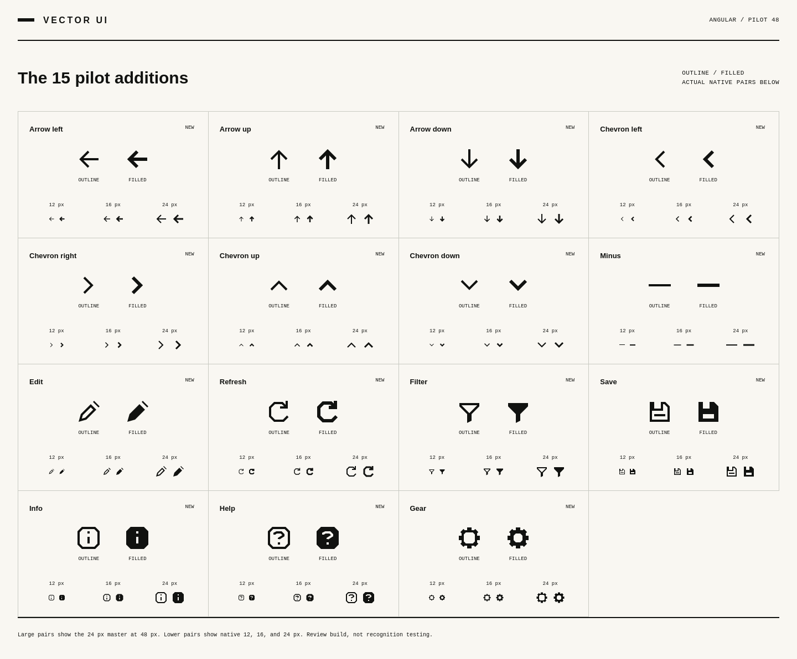

# Vector UI — Outline pilot 48

**Working name · 0.5.0-pilot.2 · private review build, not a public release**

48 canonical icons, two appearances, and three optical masters: **288 individual SVG drawings**. The original 33 concepts started from the supplied v0.4.1 baseline; the 15 additions use the same authored construction system. Every SVG either matches its pilot hash byte for byte or is listed with its old and new hash in `tests/fixtures/shape-revision-2026-11-01.json`.

Open [`docs/catalog/index.html`](docs/catalog/index.html) for the complete catalog. The HTML embeds its data and artwork; it does not load fonts, libraries, or SVGs from a network. All cards, native pairs, examples, and notes are present without JavaScript. Search, inspector, downloads, and toggles require JavaScript.



## What is finished in this pilot

- 48 icons in `outline` / `filled`, at native 12 / 16 / 24 px.
- A canonical catalog, keywords, explicit availability, provenance, pair policy, and review notes.
- A deterministic SVG/registry/sprite/catalog build; immutable baseline and pilot hashes, plus a ledger of the deliberate revisions.
- A self-contained guide with all 48 icons, 96 labeled examples, six display sizes, four surfaces, SVG inspection, and native downloads.
- An ES-module helper and 48 isolated per-icon imports. No React or Vue adapter is claimed.
- Schema, SVG safety, geometry, critical-gap, raster, export, module, and rebuild checks.
- Root GitHub Actions validation and an explicit release gate.

## What is not finished

This private pack includes 48 Outline and 12 Rounded concepts.
The legacy fillet proposal, independent design approval, recognition testing, final naming, and
publication are not included. BSD 3-Clause is selected; no package is published.

Forced-color selected controls retain the system Highlight fill and declare
CanvasText before contrast-color(Highlight). Supported browsers must implement
contrast-color(); CI and the audit use the browser revisions pinned by Playwright
1.64.1, including Chromium 156. Browser emulation does not certify physical
Windows contrast themes, screen readers, or branded Safari.

Forced-color captures use browser-emulated palettes; light and dark settings
can produce identical captures and do not establish coverage of distinct
operating-system contrast themes.

## Use the SVGs

`generated/outline/outline/16/sliders.svg`

`generated/outline/filled/24/gear.svg`

Inline SVG inherits `currentColor`. An SVG used as an `` is a separate document: parent text color does not automatically recolor it. Each raw file has a standalone title. When placing it inside a labeled button, hide the inner SVG from assistive technology instead of announcing both the icon and the button.

```html
<button type="button" aria-label="Adjust view">
  <!-- Insert the Sliders SVG inline, with aria-hidden="true" and no duplicate role/title. -->
</button>
```

## Use an isolated JavaScript import

```js
import sliders from './packages/web/icons/sliders.mjs';

// The enclosing control supplies the accessible name.
button.setAttribute('aria-label', 'Adjust view');
button.innerHTML = sliders({ appearance: 'outline', size: 16 });
```

For a named standalone symbol:

```js
import { iconSvg } from './packages/web/index.mjs';
const markup = iconSvg('info', { size: 16, title: 'About this item' });
```

The convenience API loads all icon path data. Per-icon imports reference only that icon and the shared renderer. They are not an icon font. Unknown names and unavailable styles/appearances/masters throw errors rather than silently substituting artwork. `settings` is a search keyword; use canonical `gear` or `sliders` deliberately.

## Build and check

Use CPython 3.13 and Node 22 with the maintained dependency pins in
`../requirements.txt` and `requirements-dev.txt`. Cairo is provided by the host.
Evidence records actual runtime versions; results must be rerun across toolchains.

Runners write reports and captures outside the source tree. Set
`VECTOR_UI_EVIDENCE_DIR` to an external directory shared by the runners and gate;
the Outline evidence lives in its `outline/` subdirectory. Without that setting,
a checkout-specific directory under the system temporary directory is used.
No generated test or release-status report is committed.

```sh
python -m venv .venv
# Activate the environment using the command for your shell.
python -m pip install -r requirements-dev.txt
python -m playwright install --with-deps firefox
python source/build.py
python tools/run_checks.py
```

Full browser validation requires the browser executables and their operating-system dependencies:

```sh
python -m playwright install --with-deps chromium firefox webkit
python tests/integration/browser_checks.py --browser chromium
python tests/integration/browser_checks.py --browser firefox
python tests/integration/browser_checks.py --browser webkit
```

The default browser command starts a temporary local server and requires actual HTTP, local-file, and module-consumer loading. It fails when any required loading mode fails. `--mode content` is an explicitly limited fallback; its report is marked **partial integration**, not a full pass.

To host the guide manually:

```sh
python -m http.server 8000
# Visit http://localhost:8000/docs/catalog/index.html
```

To compare committed pixel snapshots:

```sh
python tests/visual/pixel_regression.py
```

Do not use `--create-baseline` to hide a failed diff. That option is a maintainer action only after reviewing actual native renderings. The first baseline was created during this local pilot pass; independent approval remains pending.

## Repository map

```text
catalog/                 identities, availability, keywords, schemas, exceptions
source/outline/          baseline constructors and 15 authored additions
source/web/              guide presentation and behavior
source/build.py          one deterministic generation entry point
generated/outline/       288 standalone SVG assets
generated/sprites/       six size/appearance sprites and one combined sprite
packages/web/            ES-module API and isolated imports
docs/catalog/            self-contained catalog and proof pages
docs/                    design, accessibility, review, and release instructions
tests/                   fixtures, geometry, runtime, pixel and browser checks
review/                  README preview; validation captures are external
../../../.github/workflows/vector-ui-icons.yml  maintained pack CI
```

See [construction rules](docs/construction.md),
[usage restrictions](docs/usage-restrictions.md), and
[release requirements](docs/release-checklist.md).

## Validate the current tree

```sh
python tools/run_checks.py
python tests/integration/browser_checks.py --mode full --browser chromium
python tests/integration/audit_browser_checks.py --mode full --browser chromium
python tools/release_gate.py
```

Repeat both browser runners for Firefox and WebKit. Missing executables or failed
navigation are failures; content mode is only a separately labeled diagnostic.
Technical evidence binds source, tests, catalog, dependency pins, generated
outputs, workflows, and runtime versions. Fingerprints are not signatures.
Rebuilds use a clean temporary tree; validation never refreshes pixel baselines.
Unassigned exception owners, independent design review, and real recognition
evidence remain release blockers. Technical passes do not grant release approval.

The public `./render` API treats supplied paths as SVG path-data text, XML-escaping
attribute delimiters; it never accepts executable SVG markup. Titles are escaped
text too. Prefer isolated generated imports for normal drawing data.
