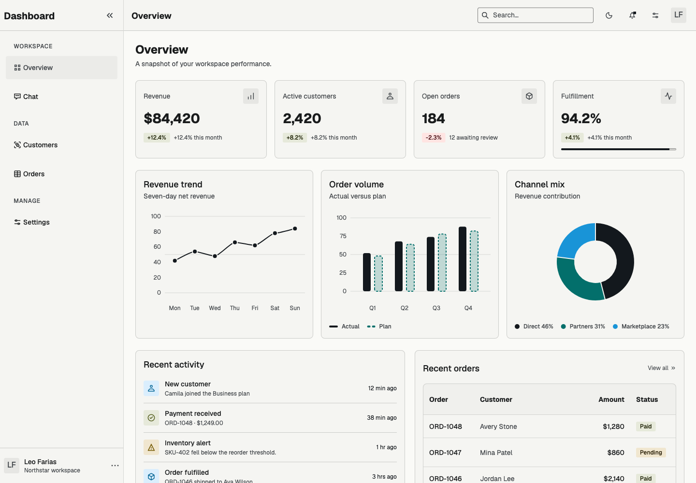

# Icon family completion

Both Outline and Rounded now cover the same 77 product concepts, with outline
and filled appearances at native 12, 16 and 24 px: 924 drawings in total.
All 360 drawings from the preceding candidate retain their source bytes and
codepoints; the completion adds 564 masters.

The screenshots use the real Flutter dashboard and compiled icon font at 1×.
The before image is candidate `f5fec577707e`, with 360 drawings and registry
fallbacks, rather than the published 0.1.0 package. The after image is
`7b9f42eb894b`, with complete native registry coverage. The dashboard now uses
a dedicated panel-overview glyph and a person glyph for Customers.

| Before completion | After completion |
| --- | --- |
|  |  |

The private review viewer contains every glyph at native and enlarged sizes,
light/dark normal/Retina captures, and the complete labeled control matrix.
It also includes a fresh dashboard installed with `iconLibrary: rounded`.
Icon sizes describe drawings; control hit areas and accessible action names
remain the enclosing component's responsibility.
